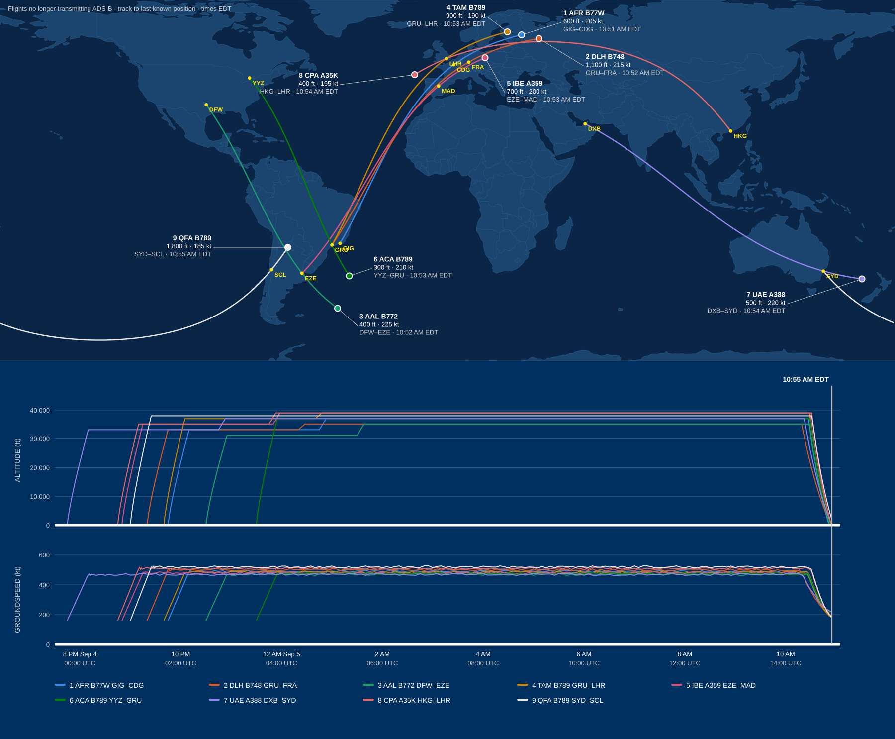

# John Hartman

### 9/5/2028, 02:05

A thud woke him. Distant and heavy, enough to rattle the bedroom window in its frame, and gone before he was fully awake. The clock read 2:05. He lay in the dark and waited: a siren, a second thud, anything that would tell him what he'd heard. Nothing came. The regular sounds of the house, and down the hall tags shifted as the dog resettled. John rolled over and went back to sleep.

He woke again at six thirty, same as every morning. Sixty-one years old and alone for sixteen of them, though not really alone. There had always been a dog, currently a mountain cur named Dan.

A hot shower, then what he called first breakfast, a blueberry, avocado, beet juice, and spinach smoothie, well it wasn't exatly smooth, but it was efficient. Gray light came in the kitchen window, the days were getting shorter which would start to  cut his walks with Dan short. He tried not to think about work on the walk, just the dog and the fresh air and first light. 

### 07:15

They headed out, Dan's tail was swinging back and forth dangerously as they walked down the driveway.

The neighborhood was quiet. Yesterday had been labor day, a short week usually had everyone out early. Instead cars that were gone at this time on a work day were still parked in driveway's like it was a Sunday morning. At the corner where the Pattersons' kids caught the school bus at 7:20, there were no kids and no bus. 

### 7:25

He checked his watch: 7:25. The quietness made him curious and he pushed past his usual turnaround, continuing to where his subdivision met Old Milton Parkway. Old Milton hadn't been quiet at any hour in years. He stood on the sidewalk at his subdivision entrance and listened, a hum, maybe, but mostly a silence that was eerie and a bit spooky, a chill ran up his spine.

"Hmm," he said out loud, his default response when the inputs on a problem didn't add up. To the north, a hundred yards away, a car sat nose-down in the drainage ditch with its lights on and he could just make out that the only sounds he was aware of were in that direction. It must have just happened. He jogged up the hill. The front of the car had gone down into a storm culvert that lifted the rear wheels off the ground and they were spinning freely. He put Dan in a sit a few yards back, went to the driver's door, and pulled it open.

A man about forty sat nearly upright, held there by the shoulder belt, his eyes open, his foot still pressing the gas pedal. Behind John, Dan's ears went flat and a thin whine started in his chest.

John reached across the man's knees, found the start button, and shut the engine off. The resulting silence was overwhelming. He checked for a pulse on the man's neck, skin was cool, almost cold, no heartbeat. This had happened hours ago, not minutes. The man's left hand hung down beside the seat, and the fingers had gone a flushed pink, like a man come in out of the cold. Not quite what John expected.

He backed away from the car and called 911 with Dan pressed against his leg.

### 7:40

It answered on the first ring, and for a second he took it for a person: a woman's voice, warm and unhurried, with a small breath before the question. "Nine-one-one, what's the address of your emergency?" It was the even, steady voice of the ubiquitious AI agent that had taken over most phone systems.

John: "Old Milton Parkway roughly one mile north of Highway 400."

"What is the emergency?" 

John: "A car accident, one car involved, the driver is dead."

"Is the driver breathing?."

John: "No." 

"Are you safe where are?"

John: "Yes."

"I'm so sorry," it said. "That's a hard thing to walk up on." 

John felt the small, stupid pull of being understood by it. Call volume was higher than usual, it told him, and a unit would be dispatched as priority allowed. Would he stay near the vehicle?

He asked for a person. It said it was an AI assistant handling the queue while the dispatchers were on other calls, that everything had been logged and that it would stay on the line as long as he liked. John hung up.

He walked south toward 400, around the bend, expecting a version of this morning that made sense. A road crew. A cop waving traffic around a wreck. The silence made him very aware of his own sounds: his boots on the sidewalk, Dan's tags clinking together.

Old Milton passed under 400. An eighteen-wheeler had jackknifed across the southbound lanes and folded against the bridge rail. The tractor had gone through the rail and hung nose-down over the road below. Nothing moving, on an ordinary Tuesday at this hour, this stretch of highway moved more people past this one spot in a minute than lived on his whole subdivision. Farther south, a column of black smoke rose into the sky.

### 7:55

He pulled up the news on his phone. The headline feed hadn't moved. The top story was six hours old with no update. He switched apps: the same frozen feed. A third. The local station's live page held a single paused frame, an anchor caught mid-word. Dan leaned hard into his leg and whined. John turned for home and walked fast, leash short, not quite running.

Back in the subdivision he heard a dog at the Morrisons', barking steady and hoarse. Another one farther down, behind a fence. A small one, high and frantic, inside a house with the blinds still down. Dan pulled toward the Morrisons' door, and John shortened the leash and kept him moving.

### 8:15
Back at the house Dan went under the kitchen table and stayed there. John opened his laptop. The same frozen feed, wider: the national wires, the overseas outlets, the social platforms that should have been a roar of overnight noise. Every one of them sat still, the newest timestamps all from a few minutes before two in the morning. Nothing was posted since.

### 8:30

At 8:30 he logged in to his standing sync call with his group at Google, the public-sector team he ran engagements for out of the D.C. office. Five minutes went by, then ten, and nobody else joined. He sat looking at his own video tile, his face was pale, jaw set, mouth thin. He closed the meeting.

He started calling people: his brother Mark first, then down the list of everyone he talked to in an ordinary week. Mostly voicemail. He left a few messages. Some numbers rang and rang. He never got a busy signal.

He set the phone down. Through the kitchen window he could hear the Morrisons' dog, still barking. Dan lifted his head off the floor and watched him.

"Harry," he said out loud.

He left Dan in the house and went next door. Harry had been his friend for twenty years. He had gotten John through the worst of it after Naomi had died. He rang the bell and waited. Nothing. He knocked. Nothing. The front door was locked. He went around to the garage and tried the code Harry had given him a few months back, and the door went up. "Harry? You here?" Nothing. Through the kitchen, the living room, down the hall to the master bedroom. "Harry?"

Harry was in bed, on his side, the blanket at his waist. "Harry?", John checked for a pulse. His friend was dead.  He pulled the blanket up over Harry's shoulder and let himself back out through the kitchen.  

He walked up the street toward the Morrisons, toward the barking. He rang the door bell and knocked, the barking got louder and vicious. He didn't know their dog and didn't think now was a good time to meet.

Next door was the Pattersons, he went to their door and rang the bell.  Nothing.  He looked through the windows on the side of the door, nobody.  "Bill, hey Bill, Judy are you there? Kids?" no response. The door was locked, he went around to the garage door, locked. Through the side gate to the back yard on the deck the back door was open.  John went in, "Bill, Judy?, "Hello? anyone here?" He walked down the hall and saw Judy and Bill in bed, "Hello?" He had to make sure, this was so awkward, the hair on the back of his neck was standing up, his stomach turning, adrenaline pumping. They were gone, the kids in their rooms, both of them dead.  He left quickly and walked home looking over his shoulder, feeling like someone was following him.

### 9:10

Dan met him at the door like it had been a week. He grabed his keys and Dan's leash, "Come on buddy, let's go for a drive." Out on to Old Milton Parkway there was no change since an hour ago. Had it only been an hour? John's mind was racing, he had not seen another living person since yesterday.  

Back out on Old Milton Parkway he headed south toward 400. The eighteen-wheeler still hung off the bridge exactly as he'd seen it earlier. He took the ramp south toward Atlanta.  Nothing was moving, a couple cars he could see were off in the ditch, one was flipped over. The black smoke he had seen earlier was still there and seemed bigger.  As he got close he saw that a truck, maybe a gas tanker, had gone off the road through a thin line of trees and the fence and crashed through the back of a retail shopping center on the east side. The retail center was fully envolved.  No emergency vehicles, no fire trucks, no sounds. 

He tried 911 again on the speaker. Same voice, same answer. He hung up. He had meant to get gas on the way home Sunday and blew it off, and now the gas light was on. Exit 8 had a QuickTrip a few blocks off 400.

The place was lit up and the pumps were on. He pulled up to pump eight. The pump took his credit card and turned on, the numbers ticking up. It was comforting to have something working like normal. 

There were two other cars at the island. A white pickup at pump two with the door open and a man face down on the concrete beside it, the pump handle still in the gas tank. A red Honda at pump five, a woman behind the wheel with her head against the window. John checked the man and then the woman, both dead. Dan watched from the back window, quiet.

He went into the store, the lights were on, country music playing low over the speakers. He went straight to the cooler and grabbed three water bottles, and drank half of one standing there. "Hello? Anybody here?" No answer.

A flat, cheerful voice from the side aisle: "Caution. Cleaning in progress." He spun around, the open water bottle flying out of his hand and onto the floor. A robot, disc-shaped, knee-high, was working up the aisle, brushes turning, a thin sheet of water and cleaner out ahead of it. It said the line again, bumped the base of a shelf, backed off a couple of inches, corrected, and kept going. John stood there a minute, he could hear his heart beating in his ears.

He found her on the floor behind the counter, wedged between the register and the cigarette rack. Twenties, maybe younger, in a QuickTrip polo. Her eyes were open, and her mouth. He checked for a pulse, her skin was cold. "So sorry," John found himself saying out loud. He left the water and went back out to the car, Dan was whining.  

### 9:51
He pulled up the map on his phone and searched for the closest fire station. North up Westside Parkway, the roads were mostly clear a few cars like the first he had discovered that day. He pulled into the Alpharetta Fire Station 83. The overhead doors were closed. He cracked the windows and left Dan in the car. The main door was open, "Hello? Anyone here?" Silence. He walked down the hall, in the kitchen there were two people in uniform laying on the floor, he checked both, same result as everyone else today, no pulse, cold. Ok, got to get out of here, John thought. Back in the car he sat staring out the windshield at the sun flashing off the glass of the overhead garage doors of the fire station. 

He pulled out the small notebook that he always kept with him to get thoughts out of his head through his fingers so his eyes could see what he was thinking. He wrote four questions:

*1. Where else?*
*2. How did this happen?*
*3. Is there anyone else alive?*
*4. Why am I alive?*

### 10:30

Considering what he had seen so far, he decided he could understand more using the tools he had back home. The drive back north on secondary roads had the same stillness, the same quiet as everything this morning. No movement, only shadows inside cars off on the side of the road, many crashed into trees, buildings, and other cars.

### 10:50

Back home, John started on his first question, Where else? He opened his laptop and pulled up FlightAware, an airplane tracking app. At this time of day there would be more than 9,000 active flights. To get a quick count he clicked on 'Browse by Aircraft Type', this view showed all the aircraft that were currently being tracked. He copied the first column that gave a count by type and dropped it into a chat: 323 aircraft. "That can't be right." he said outloud. Even though the number seemed wrong his immediate thought was, "there are others alive!"

FlightAware was a patchwork. A lot of its ground coverage came from hobbyists, thousands of people with a thirty dollar ADS-B receiver and a little antenna in a window or an attic, feeding it over their home internet. Some of what he was looking at was coming from a satellite, or an airline feed, or FlightAware filling gaps with a best guess. John had spent his career analyzing data like this, this was more than a hiccup, they must be having server issues, he thought. 

He got up from the kitchen table and walked to his office.  His team at Google were currently part of a massive AI implementation for FAA, DOT, Coast Guard, NOAA, Homeland Security, and FEMA blending commercial schedules, weather patterns, location capacity, and staffing metrics. He had access to the foundation telemetry data for road, rail, shipping, aviation, and access to station by station information on the national power grid. He docked the laptop and remoted into the the local development model that he was currently testing. It had authentication for all the related systems, the legacy ERAM and STARS from the FAA and the AIS from the Coast Gaurd. He pulled up a chat and connected the local Gemini model to the new SMART (Strategic Management of Airspace, Routes, and Trajectories) system and the MCP server for Aireon, a private company providing global satellite tracking. Now instead of scrapping the public FlightAware system he prompted the most powerful system conceived by man, "How many aircraft are currently airborne globally?", he had mostly stopped typing prompts to AI back in 2026, but still felt like Scotty from Star Trek the Journey home.. the legendary line "Computer, hello computer". The reponse came after a couple seconds and the result printed on the screen, **351**. "What is the latest departure time of these 351 flights in Eastern Daylight Time?" Response: **1:59am**. John stared at the screen. "There have been no departures globally after 1:59am?" Response: **Correct**. He had come to appreciate the brevity of this new model, no nonsense direct response zero slop, designed for quick acurate answers in fast paced environments, like air traffic control. Truth over data. Ai reverted to consensus over truth and reliable information was now the greatest demand and Google was cashing in. 

"Map all current airborne flights and generate a table of aircraft type, carrier, departure time, departure location, filed destination location, and current flight duration. Then plot all current locations and flight path on a map." This took a couple minutes, one of the boons of Google's involvent in these projects was the geospatial power of google maps. The map and table pulled up in a generated single page application. He sorted the column by departure time and realized he was missing data, the departure time in some of the source system data was a time that was filed, not actual. "Pull actual time reaching 5,000 feet above ground level for departure location and are still airborne. In a separate table list any flights that took off or landed after 2am." The still airborne output in the table showed: **342**. The second table showed: **2**. "The first output was **351**, why a lower number now?"  Response: **9 aircraft are no longer airborne.** "What is their current status?" Response: **Unknown, they all stopped transmitting ADS-B signal.** "Show me the history of these 9, with departure and destination locations, expected duration, actual duration, and the last known location and map and chart the flight activity." Response:

| # | Carrier / type | Route | Departed | Sched. arr. | Planned Flight Duration | Actual Flight Duration | Left cruise alt. | Last ADS-B | Last known location |
|---|---|---|---|---|---|---|---|---|---|
| 1 | Air France B777-300ER | Rio GIG → Paris CDG | 21:45 (4th) | 08:55 | 11:10 | 13:06 | 10:27 | 10:51 | Russia, NW shore of Lake Ladoga near Priozersk (61.0N 29.8E) |
| 2 | Lufthansa B747-8 | São Paulo GRU → Frankfurt | 21:20 | 09:00 | 11:40 | 13:31 | 10:19 | 10:52 | Russia, Vologda Oblast west of Cherepovets (59.5N 36.8E) |
| 3 | American B777-200ER | Dallas DFW → Buenos Aires EZE | 22:30 | 09:10 | 10:40 | 12:22 | 10:28 | 10:52 | South Atlantic, ~560 nm ENE of the Falklands (48.9S 44.2W) |
| 4 | LATAM B787-9 | São Paulo GRU → London LHR | 21:40 | 09:15 | 11:35 | 13:13 | 10:28 | 10:53 | Central Finland near Ähtäri (62.2N 24.1E) |
| 5 | Iberia A350-900 | Buenos Aires EZE → Madrid | 20:50 | 09:15 | 12:25 | 14:03 | 10:29 | 10:53 | Western Poland near Zielona Góra (51.8N 15.1E) |
| 6 | Air Canada B787-9 | Toronto YYZ → São Paulo GRU | 23:30 | 09:40 | 10:10 | 11:23 | 10:29 | 10:53 | South Atlantic, ~830 nm SE of São Paulo (35.9S 39.5W) |
| 7 | Emirates A380-800 | Dubai → Sydney | 19:45 (4th) | 09:45 | 14:00 | 15:09 | 10:22 | 10:54 | Tasman Sea, ~350 nm west of NZ's North Island (37.1S 166.7E) |
| 8 | Cathay Pacific A350-1000 | Hong Kong → London LHR | 20:45 (4th) | 10:05 | 13:20 | 14:09 | 10:31 | 10:54 | Atlantic, ~210 nm NW of Cape Finisterre (45.0N 13.2W) |
| 9 | Qantas B787-9 | Sydney → Santiago SCL | 21:00 (4th) | 10:05 | 13:05 | 13:55 | 10:31 | 10:55 | Northern Argentina, Salta Province near Las Lajitas (24.4S 64.2W) |

John looked at the output, none of the last locations were airports, and the last phase of the flights were rapid decents, he was looking at crash sites. 

"Based on the aircraft type and route estimate the number of souls on board these 9 aircraft."  

**~2,500** 

"How many estimated souls aboard the remaining airborne aircraft?" 

**~81,000** 

"How many aircraft were airborne at 2am?"

**9,500** 

"How many of these have completed their flight plan?"

**None, currently 337 flights still airborne.** 

"Estimate how many souls were onboard airborne flights at 2am?"
**~1.4 Million** 

Johns mouth was instantly dry and his stomach turned. 

"Are all these people dead?" 

**Unknown**

He had numbers in his phone from years of work with the agencies, the operations lines his project contacts had given him and told him to keep. FEMA's operations center in D.C. The FAA's Command Center out in Warrenton, Virginia, the room that ran traffic flow for the whole country. The Coast Guard's National Command Center in Washington.

The FEMA line rang until it dropped. The FAA's picked up on a recording that asked him to hold for the next available specialist, and he held for five minutes listening to it loop. He'd stood in that room in Warrenton. Rows of specialists at their consoles, the whole country's traffic up on the wall in front of them, a place that never closed. He knew how many people it took to staff a shift in there. "Please continue to hold," the recording said, and started over. The Coast Guard line rang and rang. No responses, no answers.

Ok, he thought, what about the 2 flights that took off or landed after 2am. He went back to look at the output table:

| # | Carrier / type | Flight ID | Route | Departed | Sched. arr. | Planned Flight Duration | Actual Flight Duration | Squawk | Event after 02:00 | Status |
|---|---|---|---|---|---|---|---|---|---|---|
| 1 | Delta Air Lines A350-900 | DAL27 | Atlanta ATL → Seoul ICN (filed) | 23:35 (4th) | 14:40 | 15:05 | 5:01 | 7700 | Turned south over northern Saskatchewan ~03:31; landed Edmonton CYEG 04:36 | On ground, Edmonton |
| 2 | Pilatus PC-12 NGX (C-GKPX) | DAL27PDK | Edmonton CYEG → no destination filed | 07:31 | — | — | 3:14 | 7700 | Departed Edmonton 07:31; landed Minneapolis-St. Paul KMSP 10:45 | On ground, Minneapolis-St. Paul |

