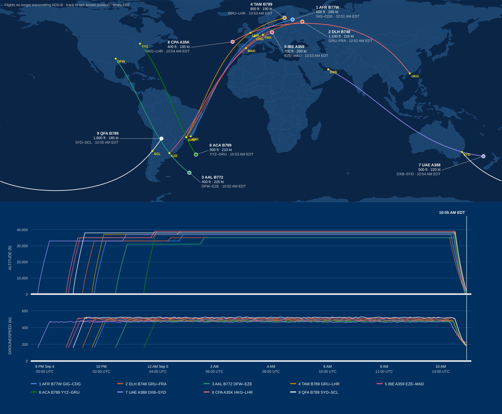

**John Hartman**

**9/5/2028, 02:05**

A thud woke him. Distant and heavy, enough to rattle the bedroom window in its frame, and gone before he was fully awake. The clock read 2:05. He lay in the dark and waited: a siren, a second thud, anything that would tell him what he'd heard. Nothing came. Just the regular sounds of the house, and down the hall, tags shifted as the dog resettled. John rolled over and went back to sleep.

He woke again at six-thirty, same as every morning. Sixty-one years old and alone for sixteen of them, though not really alone. There had always been a dog, currently a mountain cur named Dan.

A hot shower, then what he called first breakfast: a blueberry, avocado, beet juice, and spinach smoothie. It wasn't exactly smooth, but it was efficient. Gray light came in the kitchen window. The days were getting shorter, which would start to cut his walks with Dan short. He tried not to think about work on the walk—just the dog, the fresh air, and first light.

**07:15**

They headed out, Dan's tail swinging back and forth as they walked down the driveway.

The neighborhood was quiet. Yesterday had been Labor Day; a short week usually had everyone out early. Instead, cars that were gone at this time on a workday sat parked in driveways like it was a Sunday morning. At the corner where the Pattersons' kids caught the school bus at 7:20, there were no kids and no bus.

He checked his watch: 7:25. The quietness made him curious. He pushed past his usual turnaround, continuing to where his subdivision met Old Milton Parkway. Old Milton hadn't been quiet at any hour in years. He stood on the sidewalk at his subdivision entrance and listened. A distant hum, maybe, then nothing.

"Hmm," he said out loud, his default response when the inputs on a problem didn't add up.

To the north, a hundred yards away, a car sat nose-down in the drainage ditch with its lights on. The only sound came from that direction. It must have just happened. He jogged up the hill. The front of the car had gone down into a storm culvert, lifting the rear wheels off the ground so they spun freely. He put Dan in a sit a few yards back, went to the driver's door, and pulled it open.

A man about forty sat nearly upright, held there by the shoulder belt, his eyes open, his foot still pressing the gas pedal. Behind John, Dan's ears went flat and a thin whine started in his chest.

John reached across the man's knees, found the start button, and shut the engine off. The resulting silence was heavy. He checked for a pulse on the man's neck. The skin was cool, almost cold. No heartbeat. This had happened hours ago, not minutes. The man's left hand hung down beside the seat, the fingers a flushed pink, like a man come in out of the cold. Not what John expected.

He backed away from the car and called 911 with Dan pressed against his leg.

**07:40**

It answered on the first ring, and for a second he took it for a person: a woman's voice, warm and unhurried, with a small breath before the question. "Nine-one-one, what's the address of your emergency?" It was the even, steady voice of the AI agent that had taken over most phone systems.

"Old Milton Parkway," John said. "Roughly one mile north of Highway 400."

"What is the emergency?"

"A car accident. One car involved, the driver is dead."

"Is the driver breathing?"

"No."

"Are you safe where you are?"

"Yes."

"I'm so sorry," it said. "That's a hard thing to walk up on."

John felt the small, stupid pull of being understood by it. Call volume was higher than usual, it told him, and a unit would be dispatched as priority allowed. Would he stay near the vehicle?

He asked for a person. It said it was an AI assistant handling the queue while the dispatchers were on other calls, that everything had been logged, and that it would stay on the line as long as he liked. John hung up.

He walked south toward 400, around the bend, expecting a version of this morning that made sense. A road crew. A cop waving traffic around a wreck. The silence made him aware of his own sounds: his boots on the sidewalk, Dan's tags clinking together.

Old Milton passed under 400. An eighteen-wheeler had jackknifed across the southbound lanes and folded against the bridge rail. The tractor had gone through the rail and hung nose-down over the road below. Nothing moved. On an ordinary Tuesday at this hour, this stretch of highway moved more people past this one spot in a minute than lived in his whole subdivision. Farther south, a column of black smoke rose into the sky.

**07:55**

He pulled up the news on his phone. The headline feed hadn't moved. The top story was six hours old with no update. He switched apps: the same frozen feed. A third. The local station's live page held a single paused frame, an anchor caught mid-word. Dan leaned hard into his leg and whined. John turned for home and walked fast, leash short, not quite running.

Back in the subdivision, he heard a dog at the Morrisons', barking steady and hoarse. Another one farther down, behind a fence. A small one, high and frantic, inside a house with the blinds still down. Dan pulled toward the Morrisons' door, and John shortened the leash and kept him moving.

**08:15**

Back at the house, Dan went under the kitchen table and stayed there. John opened his laptop. The same frozen feed, wider: the national wires, the overseas outlets, the social platforms that should have been a roar of overnight noise. Every one of them sat still, the newest timestamps all from a few minutes before two in the morning. Nothing posted since.

**08:30**

At 8:30 he logged in to his standing sync call with his group at Google, the public-sector team he ran engagements for out of the D.C. office. Five minutes went by, then ten, and nobody else joined. He sat looking at his own pale reflection in the video tile, his jaw set. He closed the meeting.

He started calling people: his brother Mark first, then down the list of everyone he talked to in an ordinary week. Mostly voicemail. He left a few messages. Some numbers rang and rang. He never got a busy signal.

He set the phone down. Through the kitchen window he could hear the Morrisons' dog, still barking. Dan lifted his head off the floor and watched him.

"Harry," he said out loud.

He left Dan in the house and went next door. Harry had been his friend for twenty years. He had gotten John through the worst of it after Naomi died. He rang the bell and waited. Nothing. He knocked. Nothing. The front door was locked. He went around to the garage and tried the code Harry had given him a few months back, and the door went up. "Harry? You here?" Nothing. Through the kitchen, the living room, down the hall to the master bedroom. "Harry?"

Harry was in bed, on his side, the blanket at his waist. "Harry?" John checked for a pulse. His friend was dead. He pulled the blanket up over Harry's shoulder and let himself back out through the kitchen.

He walked up the street toward the Morrisons', toward the barking. He rang the doorbell and knocked. The barking got louder, vicious. He didn't know their dog and didn't think now was a good time to meet.

Next door was the Pattersons'. He went to their door and rang the bell. Nothing. He looked through the sidelights. Nobody. "Bill? Hey Bill! Judy, are you there? Kids?" No response. The front door and garage were locked. He went through the side gate to the back deck. The back door stood open. John stepped in. "Bill? Judy? Hello? Anyone here?"

He walked down the hall and saw Judy and Bill in bed. "Hello?" He forced himself to cross the carpet and make sure. Cold. Down the hall, both kids were in their rooms, gone too. He backed out of the house and walked fast toward home, looking over his shoulder.

**09:10**

Dan met him at the door like it had been a week. He grabbed his keys and Dan's leash. "Come on, buddy, let's go for a drive."

Out on Old Milton Parkway, nothing had changed since an hour ago. Had it only been an hour? He had not seen another living person since yesterday.

He headed south toward 400. The eighteen-wheeler still hung off the bridge. He took the ramp south toward Atlanta. Nothing moved. A couple of cars sat in the ditch; one was flipped over. The black smoke he had seen earlier was thicker now. As he got close, he saw that a fuel tanker had left the road, sheared through a thin line of trees and a fence, and crashed into the back of a retail shopping center on the east side. The building was fully involved. No emergency vehicles, no fire trucks, no sirens.

He tried 911 again on the speaker. Same voice, same answer. He hung up. He had meant to get gas on the way home Sunday and blew it off, and now the gas light was on. Exit 8 had a QuikTrip a few blocks off 400.

The place was lit up and the pumps were on. He pulled up to pump eight. The pump took his credit card and turned on, the numbers ticking up. It was comforting to have something working like normal.

Two other cars sat at the island: a white pickup at pump two with the door open and a man face down on the concrete beside it, the nozzle still in the tank; a red Honda at pump five, a woman behind the wheel with her head against the window. John checked the man and then the woman. Both dead. Dan watched from the back window, quiet.

He went into the store. The lights were on, country music playing low over the speakers. He went straight to the cooler, grabbed three water bottles, and drank half of one standing there. "Hello? Anybody here?" No answer.

A flat, cheerful voice came from the side aisle: "Caution. Cleaning in progress."

He spun around, the open water bottle flying out of his hand onto the floor. A knee-high, disc-shaped robot was working up the aisle, brushes turning, pushing a thin sheet of water and cleaner ahead of it. It repeated the line, bumped the base of a shelf, backed off a couple of inches, corrected, and kept going. John stood there a minute, his heartbeat thudding in his ears.

He found the clerk on the floor behind the counter, wedged between the register and the cigarette rack. Twenties, maybe younger, in a QuikTrip polo. Her eyes and mouth were open. He checked for a pulse. Cold. "So sorry," John said out loud. He left the water and went back out to the car, where Dan was whining.

**09:51**

He pulled up the map on his phone and searched for the closest fire station. North up Westside Parkway, the roads were mostly clear, save for a few cars off the shoulder like the first one he had found. He pulled into Alpharetta Fire Station 83. The overhead doors were closed. He cracked the windows and left Dan in the car.

The main door was unlocked. "Hello? Anyone here?" Silence. He walked down the hall. In the kitchen, two firefighters in uniform lay on the floor. He checked both. Same result as everyone else today: no pulse, cold.

Back in the car, he sat staring out the windshield at the sun flashing off the glass of the bay doors. He pulled out the small notebook he always carried to get thoughts out of his head and see what he was thinking. He wrote four questions:

*1. Where else?*
*2. How did this happen?*
*3. Is there anyone else alive?*
*4. Why am I alive?*

**10:30**

Considering what he had seen so far, he could understand more using the tools he had back home. The drive north on secondary roads held the same stillness, the same quiet as everything this morning. No movement, only shadows inside cars off the side of the road, many crashed into trees, buildings, and other vehicles.

**10:50**

Back home, John started on his first question: *Where else?* He opened his laptop and pulled up FlightAware. At this time of day, there should be more than 9,000 active flights. To get a quick count, he clicked on 'Browse by Aircraft Type' to view all tracked aircraft. He copied the first column giving the count by type and dropped it into a chat.

**323 aircraft.**

"That can't be right," he said out loud. Even though the number seemed wrong, his immediate thought jumped ahead: *There are others alive.*

FlightAware was a patchwork. Much of its ground coverage came from hobbyists—thousands of people with a thirty-dollar ADS-B receiver and a small antenna in a window or an attic, feeding data over their home internet. The rest came from satellites, airline feeds, or FlightAware filling gaps with best-guess estimates. John had spent his career analyzing data like this. This was more than a server hiccup.

He got up from the kitchen table and walked to his office. His team at Google was part of a massive AI integration across the FAA, DOT, Coast Guard, NOAA, Homeland Security, and FEMA—blending commercial schedules, weather patterns, location capacity, and staffing metrics. He had access to the foundational telemetry for road, rail, shipping, and aviation, plus station-by-station data on the national power grid.

He docked the laptop and remoted into the local development model he had been testing. It held live authentication for the legacy FAA ERAM and STARS systems and the Coast Guard's AIS. He opened a terminal, connected the local Gemini model to the FAA's SMART (Strategic Management of Airspace, Routes, and Trajectories) architecture and the MCP server for Aireon's global satellite tracking, and keyed his mic.

"How many aircraft are currently airborne globally?"

The response printed two seconds later.

**351.**

"What is the latest departure time of these 351 flights in Eastern Daylight Time?"

**1:59am.**

John stared at the screen. "There have been no departures globally after 1:59am?"

**Correct.**

He appreciated the model's brevity—direct, zero slop, built for air traffic control environments where operators needed ground truth over consensus data.

"Map all current airborne flights and generate a table of aircraft type, carrier, departure time, departure location, filed destination location, and current flight duration. Plot all current locations and flight paths on a map."

The single-page application rendered a couple of minutes later. He sorted the table by departure time and spotted a flaw: some of the source systems reported filed departure times rather than actual wheels-up times.

"Filter for aircraft still airborne using actual time reaching 5,000 feet AGL after departure. In a separate table, list any flights that took off or landed after 2:00am."

The first table updated: **342**. The second table showed: **2**.

"The first output was 351. Why a lower number now?"

**9 aircraft are no longer airborne.**

"What is their current status?"

**Unknown. All 9 stopped transmitting ADS-B signals.**

"Show me the history of those 9 with departure and destination locations, planned duration, actual duration, and last known location, and chart their flight activity."

| # | Carrier / type | Route | Departed | Sched. arr. | Planned Flight Duration | Actual Flight Duration | Left cruise alt. | Last ADS-B | Last known location |
|---|---|---|---|---|---|---|---|---|---|
| 1 | Air France B777-300ER | Rio GIG → Paris CDG | 21:45 (4th) | 08:55 | 11:10 | 13:06 | 10:27 | 10:51 | Russia, NW shore of Lake Ladoga near Priozersk (61.0N 29.8E) |
| 2 | Lufthansa B747-8 | São Paulo GRU → Frankfurt | 21:20 | 09:00 | 11:40 | 13:31 | 10:19 | 10:52 | Russia, Vologda Oblast west of Cherepovets (59.5N 36.8E) |
| 3 | American B777-200ER | Dallas DFW → Buenos Aires EZE | 22:30 | 09:10 | 10:40 | 12:22 | 10:28 | 10:52 | South Atlantic, ~560 nm ENE of the Falklands (48.9S 44.2W) |
| 4 | LATAM B787-9 | São Paulo GRU → London LHR | 21:40 | 09:15 | 11:35 | 13:13 | 10:28 | 10:53 | Central Finland near Ähtäri (62.2N 24.1E) |
| 5 | Iberia A350-900 | Buenos Aires EZE → Madrid | 20:50 | 09:15 | 12:25 | 14:03 | 10:29 | 10:53 | Western Poland near Zielona Góra (51.8N 15.1E) |
| 6 | Air Canada B787-9 | Toronto YYZ → São Paulo GRU | 23:30 | 09:40 | 10:10 | 11:23 | 10:29 | 10:53 | South Atlantic, ~830 nm SE of São Paulo (35.9S 39.5W) |
| 7 | Emirates A380-800 | Dubai → Sydney | 19:45 (4th) | 09:45 | 14:00 | 15:09 | 10:22 | 10:54 | Tasman Sea, ~350 nm west of NZ's North Island (37.1S 166.7E) |
| 8 | Cathay Pacific A350-1000 | Hong Kong → London LHR | 20:45 (4th) | 10:05 | 13:20 | 14:09 | 10:31 | 10:54 | Atlantic, ~210 nm NW of Cape Finisterre (45.0N 13.2W) |
| 9 | Qantas B787-9 | Sydney → Santiago SCL | 21:00 (4th) | 10:05 | 13:05 | 13:55 | 10:31 | 10:55 | Northern Argentina, Salta Province near Las Lajitas (24.4S 64.2W) |

John studied the output. None of the last known locations were airports, every flight had flown past its planned duration by an hour or more, and the final telemetry profiles showed rapid descents from cruise altitude. Fuel starvation. He was looking at nine crash sites.

"Based on aircraft type and route, estimate the souls on board those 9 aircraft."

**~2,500**

"How many estimated souls aboard the remaining airborne aircraft?"

**~81,000**

"How many aircraft were airborne at 2:00am?"

**9,500**

"How many of those have completed their flight plan?"

**None. Currently 337 flights remain airborne.**

"Estimate how many souls were onboard airborne flights at 2:00am."

**~1.4 Million**

John's mouth went dry and his stomach turned. "Are all these people dead?"

**Unknown.**

He pulled up his team's active contacts list: FEMA's operations center in D.C., the FAA Command Center in Warrenton, Virginia, and the Coast Guard's National Command Center in Washington.

The FEMA line rang until it dropped. The FAA line picked up on an automated recording asking him to hold for the next available specialist. He held for five minutes, listening to it loop. He had stood on that floor in Warrenton—rows of specialists at their consoles, the entire country's air traffic up on the wall in front of them, a room that never closed. He knew how many people it took to staff a shift in there. "Please continue to hold," the recording repeated. The Coast Guard line rang and rang. No answers.

He scrolled down to the second table—the two flights that had either taken off or landed after 2:00 AM:

| # | Carrier / type | Flight ID | Route | Departed | Sched. arr. | Planned Flight Duration | Actual Flight Duration | Squawk | Event after 02:00 | Status |
|---|---|---|---|---|---|---|---|---|---|---|
| 1 | Delta Air Lines A350-900 | DAL27 | Atlanta ATL → Seoul ICN (filed) | 23:35 (4th) | 14:40 | 15:05 | 5:25 | 7700 | Squawked 7700 northwest of Lake Athabasca ~03:25; turned south over Great Slave Lake ~03:40; landed Edmonton CYEG 05:00 | On ground, Edmonton |
| 2 | Pilatus PC-12 NGX (C-GKPX) | DAL27PDK | Edmonton CYEG → no destination filed | 07:31 | — | — | 3:14 | 7700 | Departed Edmonton 07:31; landed Minneapolis-St. Paul KMSP 10:45 | On ground, Minneapolis-St. Paul |
