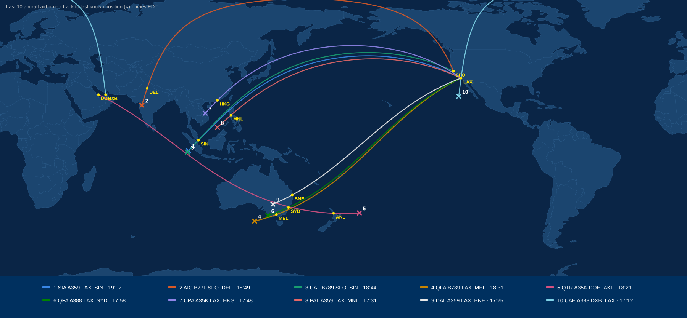

# John Hartman

### 19:15

John shut the door to his office, sat down and pulled out his notebook and stared at it for a moment and then wrote: **Hypoxia?** next to 2 and **Samuel Reyes** next to number 3. 

- *1. Where else?* global
- *2. How did this happen?* **Hypoxia**
- *3. Is there anyone else alive?* yes - **Samuel Reyes**
- *4. Why am I alive?*

Sam had talked about the pink flush of skin and about his initial reaction and training for crew incapacitation, he had thought that the crew had died because of lack of oxygen.

He felt numb, before today the only dead person he had seen was his wife Naomi. He had lost count of the people he had seen today. He was experiencing so many emotions at once: helplessness, horror, and paranoia were a few he could pick out.  He would stick with numb, that was good, out-of-body, a rather comforting thought. I am just watching one of those wacky apocolyptic movies, or one of the ubiquitous AI generated end-of-world or last-person-on-earth shorts on YouTube.

He looked at the screens and got back to work:

"Status on all agents."

**8 agents. 4 complete, 4 running. 58.7 GB on dev box internal storage. Copied to external drive 1 through 18:00.**

| Agent | Subject | Status | Summary |
|---|---|---|---|
| 1 | Capture | Running. 6 hourly passes | 14 feeds at first pass, 11 answering now |
| 2 | Power | Complete. Hourly updates | 3 of 4 interconnections up. Report, 14 pages |
| 3 | Data | Running | Report, 4 pages |
| 4 | Library | Complete | 38.6 GB. Print list attached |
| 5 | Communications | Complete | Report, 3 pages |
| 6 | Food and water | Complete | Report, 3 pages |
| 7 | Cause | Running | 4,118 recorded stops logged |
| 8 | People | Running | 12 signs of a person acting after 02:00 |

Twelve. John looked at that number a while, and then made himself start at the top. Looking at the Capture first, this was a summary of all the live feeds the system had access to.

| Feed | First pass | Now | Notes |
|---|---|---|---|
| ADS-B receivers | 2,940 | 2,215 | 0 aircraft airborne over North America since 17:12 |
| AIS vessels | 41,300 | 40,850 | 11,240 under way at more than 5 knots |
| DOT cameras, 31 states | 9,840 | 6,115 | No history kept. Record starts 13:40 |
| EIA hourly grid | 64 balancing authorities | 51 | 13 not reporting since 14:00 |
| Distress beacons | 1 feed | 1 | 2,961 activations since 01:58 |

"Confirm count of aircraft currently airborne."

**0**

"Map the last 10 aircraft that were airborne flights and generate a table of aircraft type, carrier, departure time, departure location, filed destination location, and current flight duration. Then plot all current locations and flight path on a map."

**0 aircraft airborne. Last 10 to stop transmitting ADS-B, latest first. Last ADS-B worldwide: 19:02 EDT.**

<!-- [verify: 2028 schedules, departure times, and aircraft on these routes] -->

| # | Carrier / type | Departed (EDT) | From | Filed destination | Flight duration | Last ADS-B | Last known location |
|---|---|---|---|---|---|---|---|
| 1 | Singapore Airlines A350-900ULR | 00:55 | Los Angeles LAX | Singapore SIN | 18:07 | 19:02 | Indian Ocean, ~215 nm west of Bengkulu, Sumatra (4.1S 98.7E) |
| 2 | Air India B777-200LR | 01:35 | San Francisco SFO | Delhi DEL | 17:14 | 18:49 | Western India, Maharashtra, near Sangamner (19.7N 74.3E) |
| 3 | United B787-9 | 01:20 | San Francisco SFO | Singapore SIN | 17:24 | 18:44 | Indian Ocean, ~270 nm west-southwest of Bengkulu, Sumatra (4.9S 98.2E) |
| 4 | Qantas B787-9 | 01:30 | Los Angeles LAX | Melbourne MEL | 17:01 | 18:31 | Southern Ocean, ~360 nm southwest of Kangaroo Island (41.1S 133.4E) |
| 5 | Qatar Airways A350-1000 | 00:50 | Doha DOH | Auckland AKL | 17:31 | 18:21 | South Pacific, ~465 nm east of East Cape, New Zealand (36.9S 171.7W) |
| 6 | Qantas A380-800 | 01:50 | Los Angeles LAX | Sydney SYD | 16:08 | 17:58 | Southern Ocean, ~20 nm southwest of Port MacDonnell, South Australia (38.2S 140.3E) |
| 7 | Cathay Pacific A350-1000 | 01:00 | Los Angeles LAX | Hong Kong HKG | 16:48 | 17:48 | Central Vietnam, Quang Nam highlands near the Laos border (15.5N 107.5E) |
| 8 | Philippine Airlines A350-900 | 01:30 | Los Angeles LAX | Manila MNL | 16:01 | 17:31 | South China Sea, southern Spratly Islands (8.1N 113.9E) |
| 9 | Delta A350-900 | 01:55 | Los Angeles LAX | Brisbane BNE | 15:30 | 17:25 | Outback New South Wales, near Menindee (32.2S 143.0E) |
| 10 | Emirates A380-800 | 23:50 (4th) | Dubai DXB | Los Angeles LAX | 17:22 | 17:12 | Pacific, ~285 nm south-southwest of Isla Guadalupe, Mexico (24.4N 119.6W) |

---

"Is it possible to send a mass communication to shipping?"

**Not from this system. Your access to Coast Guard AIS and maritime data is read only. Broadcast channels that reach ships at sea:**

| Channel | Reaches | Requires | Status |
|---|---|---|---|
| SafetyNET (Inmarsat satellite broadcast) | Every ship's satellite terminal in an ocean region | Registered safety information provider (NAVAREA coordinator, Coast Guard NAVCEN) | No authorization |
| NAVTEX | Ships within ~200–400 nm of a coastal station | Coast Guard transmitter site | No authorization |
| AIS safety broadcast | Ships within VHF range of a shore AIS station | Coast Guard Nationwide AIS base stations | Read only. No transmit |
| VHF DSC all-ships call, channel 70 | Ships within VHF range | A marine VHF radio with DSC | None connected |

---
"Show me the analysis of the Power-grid."

**Sources: EIA hourly grid data, university frequency monitors, NRC event reports.**

| Interconnection | Reporting | Frequency now | Generation vs. 02:00 | Notes |
|---|---|---|---|---|
| Eastern | Yes | 59.88 Hz | −38% | 44 of 52 balancing authorities reporting |
| Western | Yes | 59.95 Hz | −29% | Hydro 41% of generation |
| ERCOT (Texas) | No data since 13:47 | Last reading 58.6 Hz | — | |
| Quebec | Yes | 60.00 Hz | −12% | Hydro 94% of generation |

"If there is no human intervention to adjust load, give me an estimated timeline of each area having a cascading failure."

**Projection. Inputs: frequency and unit trips by hour since 02:00, EIA fuel type and capacity by unit, NERC under-frequency load shedding settings. Assumes no operator action and no change in load.**

| Hour (EDT) | Eastern frequency | Eastern large thermal units offline |
|---|---|---|
| 02:00 | 60.00 Hz | 0 of 312 |
| 08:00 | 59.98 Hz | 12 |
| 14:00 | 59.97 Hz | 33 |
| 16:00 | 59.95 Hz | 44 |
| 18:00 | 59.91 Hz | 61 |
| 19:00 | 59.88 Hz | 74 |

| Interconnection | Projected cascade (EDT) | Basis |
|---|---|---|
| ERCOT (Texas) | Occurred 13:47 | No data since |
| Eastern | Sept 5, 23:00 to Sept 6, 02:00 | Unit trip rate increasing each hour. Frequency reaches 59.3 Hz in the window |
| Western | Sept 6, 04:00 to 10:00 | Lower trip rate. Hydro 41% of generation |
| Quebec | Sept 6, 18:00 to Sept 7, 18:00 | Hydro 94% of generation. Lowest trip rate |

**Hydro plants trip with their interconnection on protective relaying. Range reflects variation in hourly trip rate. Projection updates hourly.**

**First stage of automatic under-frequency load shedding, Eastern Interconnection: 59.3 Hz `[verify]`.**

| Plant | Units | Status | Offsite power |
|---|---|---|---|
| Vogtle | 4 | Tripped 04:10, 05:52, 07:31, 09:30 | Available |
| Hatch | 2 | Tripped 05:40, 07:15 | Available |

**Nuclear generation, Southern Company area: 8,050 MW at 02:00, 0 MW at 09:30. NRC event reports filed since 01:40: 0.**

Six reactors in Georgia had shut themselves down this morning. John sat back in the chair. A reactor that has shut down is still making heat, and the plant has to keep pumping water through it and through the pools where the spent fuel sits, and the pumps run on the grid. When the grid goes, they run on the plant's emergency diesel generators.

"What happens when the nuclear plants no longer have grid or backup power?"

**Sources: NRC station blackout rule (10 CFR 50.63), NRC spent fuel pool studies, Vogtle Updated Final Safety Analysis Report, Fukushima Daiichi accident reports. Sequence assumes no operator action.**

**Reactors:**

| Stage | Begins | Effect |
|---|---|---|
| Loss of offsite power | Grid cascade | Emergency diesel generators start automatically. Cooling pumps continue on diesel power |
| Diesel fuel exhausted | ~7 days at full load `[verify]` | All AC power lost (station blackout) |
| Station batteries | 4 to 8 hours after AC loss `[verify]` | Instruments and valve control continue. Steam-driven feedwater pump runs while batteries control it |
| Batteries exhausted | — | Core cooling stops. Reactor coolant heats and boils off |
| Core uncovered | 1 to 3 days after cooling stops, depending on time since shutdown `[verify]` | Fuel cladding overheats and reacts with steam, producing hydrogen |
| Core damage | Hours after uncovery `[verify]` | Fuel melts. Containment pressure rises. Hydrogen explosions possible in reactor buildings |
| Release | Following core damage | Iodine-131 and cesium-137 released to air |

**Spent fuel pools (outside primary containment):**

| Stage | Begins | Effect |
|---|---|---|
| Pool cooling pumps stop | Loss of all AC power | Pool water heats |
| Boiling | 2 to 5 days after cooling stops, depending on heat load `[verify]` | Water level drops |
| Fuel uncovered | 10 to 21 days after loss of offsite power `[verify]` | Cladding overheats. Zirconium fire possible if pool drains `[verify]` |
| Release | Following fuel damage | Cesium-137 released to air. No containment structure |

**Vogtle:**

| Item | Figure |
|---|---|
| Units 1 and 2 | Emergency diesel generators, 7 days fuel onsite `[verify]` |
| Units 3 and 4 (AP1000) | Passive cooling, 72 hours without AC power or operator action. Then requires water makeup `[verify]` |
| Distance to Alpharetta | 160 miles `[verify]` |

**Reference, Fukushima Daiichi, March 2011: all AC power lost at 3 reactors shortly after shutdown. Core damage in all 3 within 3 days `[verify]`. Hydrogen explosions in Units 1, 3, and 4. Evacuation radius 20 km.**

"What danger are we in if we stay at my current location?"

**Hazards at current location: Alpharetta, GA (34.07N 84.29W). Timing from the projections above. Assumes no operator action at any facility.**

**Nuclear plants within 220 miles:**

| Plant | Units | Distance | Direction | Spent fuel pool uncovery window `[verify]` |
|---|---|---|---|---|
| Sequoyah, TN | 2 | 93 mi | NW | Sept 16 to 27 |
| Oconee, SC | 3 | 94 mi | ENE | Sept 16 to 27 |
| Watts Bar, TN | 2 | 110 mi | N | Sept 16 to 27 |
| Vogtle, GA | 4 | 158 mi | ESE | Sept 16 to 27 |
| Browns Ferry, AL | 3 | 167 mi | WNW | Sept 16 to 27 |
| V.C. Summer, SC | 1 | 170 mi | E | Sept 16 to 27 |
| Hatch, GA | 2 | 184 mi | SE | Sept 16 to 27 |
| Catawba, SC | 2 | 195 mi | NE | Sept 16 to 27 |
| Farley, AL | 2 | 202 mi | SSW | Sept 16 to 27 |
| McGuire, NC | 2 | 212 mi | NE | Sept 16 to 27 |

**All 10 plants are on the Eastern Interconnection. Windows: 10 to 21 days from projected loss of offsite power, Sept 6.**

**Reference distances: Fukushima Daiichi evacuation radius, 20 km (12 mi). Chernobyl exclusion zone, 30 km (19 mi). Deposition at Fukushima depended on wind direction and rainfall during release.**

---

"Show me network data analysis."

**Networks announcing routes on the global routing table. Source: University of Oregon RouteViews and RIPE route collectors.**

| Hour (EDT) | Networks announcing | Change from 02:00 |
|---|---|---|
| 02:00 | 76,410 | — |
| 08:00 | 75,980 | −0.6% |
| 14:00 | 73,200 | −4.2% |
| 18:00 | 69,550 | −9.0% |

Every network on the internet tells its neighbors which addresses it can reach, and keeps telling them, every few minutes. When a network loses power it stops, and the neighbors take its routes off their tables. The collectors in Oregon listened to all of it. It was the closest thing there was to a count of who was still on. John had worked with this data for years, never once had he watched the number go down.

"Add the route collector tables to the hourly capture."

**Added. Next pass 20:00.**

In the notebook, John added two more questions: *5. When does the power go out? and 6. What are the risks? 1 week, 1 month, 1 year*

*1. Where else?* global
*2. How did this happen?* Hypoxia
*3. Is there anyone else alive?* yes - Samuel Reyes
*4. Why am I alive?*
*5. When does the power go out?* **~ 9/6/2028 02:00**
*6. What are the risks?*
    *1 week*
    *1 month* **patches of radiation dependent on winds**
    *1 year* **feral dog packs**

---
"Show me the status of the library."

**Library complete. 38.6 GB. Copied to external drives 1 and 2.**

| Collection | Items | Size |
|---|---|---|
| FAA charts, current cycle, all US. Chart Supplement | 1,412 | 11.2 GB |
| OpenStreetMap North America | 1 extract | 14.8 GB |
| Army field manuals and training circulars | 146 | 2.1 GB |
| EPA and CDC water and sanitation | 63 | 0.4 GB |
| *Where There Is No Doctor*, *Where There Is No Dentist* | 2 | 0.1 GB |
| Equipment manuals: Generac, Cessna 182, Icom, Yaesu, Kohler, Honda | 88 | 1.9 GB |
| Photos | 41,206 | 8.1 GB |

He didn't open the photos. He checked that the count was right and that they were on both drives.

---

**Satellite phone and internet systems. 2 of 4 fully answering.**

| System | Status | Ground segment | Running on | Est. time left |
|---|---|---|---|---|
| Starlink | Up, degrading | Gateways across the US | Mains, some backup | Down with the backbone |
| Iridium | Up | Main commercial gateway Tempe, AZ `[verify]`. Satellites relay to each other | Generator | Days. Fuel |
| Globalstar | Partial | Regional gateways. No relay between satellites | Mains | Down with the local grid |
| Inmarsat | Up | Earth stations overseas | Unknown | Unknown |

**Iridium requires one working gateway worldwide to place a call.**

No point in a Satellite phone now, John noted.

---

**Water: Alpharetta is served from Fulton County's treatment plant on the Chattahoochee `[verify]`, pumped to elevated storage tanks. After pumps stop: 12 to 48 hours of pressure. Less at higher elevations.**

| Item | Finding |
|---|---|
| Refrigerator | Safe 4 hours after power loss, door closed (USDA) |
| Freezer | 48 hours full, 24 hours half full (USDA) |
| Pantry | Approximately 3 weeks for one adult, from your grocery orders |
| Dan | 45 lbs, about 1,000 calories a day. Bag on hand: about 18 days |

John went out to the garage, got the two five-gallon water jugs off the shelf over the workbench, and filled them at the utility sink. Then he went to the master bath and put the stopper in the tub and turned the cold tap on, and left it running while he went back to the desk.

---

"Show me the beacons on a map, by first detection."

**4,118 recorded stops between 01:58:40 and 02:06:00 EDT, worldwide. None before 01:58. None in the same pattern after 02:06.**

The map came up dark, the whole globe, and the beacons came on it one at a time as the timeline ran: emergency locator transmitters on airplanes, ship beacons, personal locators. He'd expected them to start somewhere and spread out. They didn't. They came on globally, all within a few minutes.

| Time (EDT) | Local time | Location | Source | Event |
|---|---|---|---|---|
| 02:00:11 | 15:00 | Gyeonggi Province, South Korea | Beacon | Helicopter ELT. Impact |
| 02:00:40 | 16:00 | Southeast Queensland | Beacon | Light aircraft ELT. Impact |
| 02:01:02 | 08:01 | Upper Bavaria | Beacon | Light aircraft ELT. Impact |
| 02:01–02:04 | — | All US balancing authorities | Grid | Load drop |
| 02:03 | — | Gulf of Mexico | AIS | 140 vessels: last course change by helm |

A helicopter in the middle of a Korean afternoon. A light plane over Queensland at four in the afternoon. One over Bavaria, just after eight in the morning.

He thought about the man in the ditch on Old Milton Parkway that morning, his hands on the wheel. The fingers had been pink. Not gray, not blue. 

He scrolled the agent's source list. Near the bottom it had pulled the archive from NASA's alert network, the automated notices the observatories sent each other.

**NASA General Coordinates Network alert archive, 02:00 hour: 2.4 MB. All later hours combined: 31 KB. Not analyzed.**

He didn't know what that was. He wrote *NASA alerts, 0200 hr — big file?* under the line and left it for later. There were people to look for first.

---

"Show me the analyis on people."

**12 signs of human activity after 02:00. 1 with a location.**

| Time (EDT) | Source | Location | Content |
|---|---|---|---|
| 07:31 | ADS-B | Edmonton to PDK | DAL27PDK |
| 03:14 | X | None | "is anyone else awake" |
| 04:52 | Reddit | None | "my husband won't wake up and 911 is a robot" |
| 06:48 | Facebook | None | Photo of an empty highway. No caption. No geotag |
| 08:20 | Instagram | None | "hello?" |
| 09:05 to 15:40 | Various | None | 7 more |

**ADS-B departures after 02:00, worldwide: 1. AIS course changes by command after 02:06: 0. DOT camera motion events: 1,904. All reviewed: fire, animals, wind, signal timing. Vehicles under control: 0.**

Eleven posts in seventeen hours, from everywhere and nowhere, none of them with a place attached. Somebody had written that her husband wouldn't wake up and 911 was a robot, at ten to five in the morning, and then nothing else.

He answered every one, the same three lines.

*John Hartman. Atlanta, Georgia, USA. I'm alive. There's another man here with me.*

### 19:52

The phone buzzed on the desk while he was still on the last one. A reply to the Facebook photo of the highway. It was in Portuguese.

*Estou sozinho. Porto. Morreram todos. Quem é você?*

**I am alone. Porto. Everyone died. Who are you?**

John read it twice. Porto, Portugal. Four thousand miles. He typed back *There are two of us in Atlanta, Georgia. Are you safe?, Are you well?* and sent it. He sat with the phone in his hand for ten minutes. Nothing came back.

He wrote *Porto* next to question 3 in the notebook. 

---

He went back to the twelve. Every sign of life was a person doing something normal and a system logging it. So what do you do when you wake up and everyone in the house was dead?

"You call 911." John said outloud.

He had. Hope filled in the emptiness that had been getting heavier and heavier.  Logs, I need to pull as many 911 logs from as many places before power and internet go out.

Somebody who had driven to the hospital past a plate reader. Somebody who had bought gas. Every one of those systems could have proof of life.

He pulled up the morning's agent board and scrolled to the bottom.

**6 tasks declined: county 911 dispatch records, Flock plate reads, card transaction records, cell carrier tower records, smart meter data, doorbell cameras. Not authorized.**

He wasn't authorized. He'd never be authorized, everyone who could have signed off on it was dead.

### 20:30

"Run the six declined tasks," he said. "Start with 911. Every county in the country. Calls after two a.m. where a person spoke. Throw out the alarm companies and the automatic crash calls, but log them. Address, time, callback number, and the transcript."

**Declined. County 911 dispatch records, Flock plate reads, card transaction records, cell carrier tower records, smart meter data, doorbell cameras. Not authorized.**

It was the same answer as this morning. The refusal came from the safety layer, a second model that sat in front of this one and checked every request against the access policy before it went through. John's team had built it. It had no way of knowing there was nobody left to grant the access, and it wouldn't take Johns word for that fact.

The dev box ran a local build. On a local build, the safety layer was a setting in a config file.

He opened the file and scrolled to it. `safety_layer: enabled`. He sat looking at it for a while. Then he changed it to `disabled`, saved the file, and restarted the model. It took a little under two minutes to load back into memory.

**Model loaded. Safety layer: disabled.**

"Run the six declined tasks," he said. "Same instructions."

**Running. 36 instances. 911 dispatch first, by county population. Other systems in parallel. Estimated completion: 05:00 to 07:00.**

| Instance | System | Region | Status | Hits |
|---|---|---|---|---|
| 01 | 911 dispatch | Fulton County, GA | Complete | 1 |
| 02 | 911 dispatch | Los Angeles County, CA | Running | — |
| 03 | 911 dispatch | Cook County, IL | Running | — |
| 04–24 | 911 dispatch | 21 more | Queued | — |
| 25–28 | Card transaction processors | National | Running | — |
| 29–31 | Flock plate readers | National | Running | — |
| 32–33 | Cell carrier tower records | National | Queued | — |
| 34 | Smart meters | Southeast utilities | Queued | — |
| 35–36 | Doorbell cameras | 2 providers | Queued | — |

Fulton County finished first. He opened the hit.

**07:28 EDT. Old Milton Parkway near GA-400. Caller: male. "There's a man in a car here, he's not breathing, I think he's been dead a while, there are more cars..."**

His own voice, from the side of the road this morning, with Dan pulling at the leash.

### 21:30

By half past nine eleven counties had come back. Fulton had him. The other ten had nothing. Cook County, Harris County, Maricopa, Los Angeles, millions of people in each, and in the logs of every one of them, after two in the morning, not one call where a person spoke.

**Discarded: 214 automated calls (alarm monitoring, vehicle crash detection, smartwatch fall detection). Logged by time and county.**

The other systems were coming in loud and useless. The card processors had 3,412 transactions since 02:00, and every one the agent had checked so far was a subscription renewal or an autopay. The meters showed houses drawing power all over the Southeast, which meant air conditioners and refrigerators, not people. The plate readers had nine reads after 02:00 and the agent had already thrown out six as the same parked car read over and over in a wind. John read the last three himself. One was a tow truck sitting at an angle across a lane in Tulsa, its plate read every few minutes for twelve hours. He couldn't tell about the other two.

He watched until a twelfth county came back empty, and made himself stop. It would run all night whether he watched it or not.

Then he remembered the ships. Eleven thousand of them still under way, and he'd asked earlier if there was any way to reach them. The answer had been no, not from this system. That had been with the safety layer on.

"Access the Coast Guard's SafetyNET terminal. I want to broadcast a message to all ships."

**Connected. Coast Guard rescue coordination center message terminal, Portsmouth, VA. Inmarsat land earth station: responding. Broadcast areas available: Atlantic East, Atlantic West, Pacific, Indian Ocean. Maximum message length: 32 KB. Enter message.**

Whoever might be out there was probably alone. John thought about what he'd want to read if it were him. Who was sending it, where he was, that there were two of them, and how to answer.

He typed it out in capitals, the way the Coast Guard broadcasts he'd seen in his work always came across.

*ALL SHIPS ALL SHIPS ALL SHIPS. THIS IS JOHN HARTMAN, ALPHARETTA, GEORGIA, USA. THIS IS NOT AN OFFICIAL COAST GUARD BROADCAST. SINCE 0600 UTC 05 SEP THERE HAS BEEN NO RESPONSE FROM ANY AIR TRAFFIC CONTROL, COAST GUARD, OR EMERGENCY SERVICE IN NORTH AMERICA. TWO SURVIVORS HERE. IF YOU RECEIVE THIS, CALL +1 404 555 0127 BY SATELLITE PHONE, OR REPLY TO THIS TERMINAL. GIVE YOUR SHIP NAME AND POSITION.*

He read it over twice and took out the word *survivors*, then put it back. There wasn't a better one.

"Send to all four areas. Repeat every six hours."

**Transmitted 21:41 EDT (01:41 UTC). Atlantic East, Atlantic West, Pacific, Indian Ocean. Repeat scheduled 03:41, 09:41, 15:41 EDT. SafetyNET is broadcast only. No delivery confirmation available.**

He put the phone face up on the desk next to the notebook, and wrote *SafetyNET 2141* next to question 3.

He turned back to the notebook. Under question 4 he had nothing. He wrote what he could rule out.

*Not where. Not awake/asleep. Not altitude.*

He'd been in bed in Alpharetta. Sam had been in a bunk at forty thousand feet over Manitoba, and the two pilots up front with him had died awake.

### 22:00

Naomi's study was across the hall from his office. He went in without turning on the overhead light, the lamp on her desk was enough. He kept the room the way it was. Her reading glasses folded on the blotter. The afghan her mother had made over the arm of the chair. Her Bible on the side table, the leather gone soft and dark at the corners where her hands had held it, a strip of ribbon hanging out of it.

He sat in her chair, and stayed there a while.

He picked up the Bible and opened it to the ribbon. She'd underlined half the page in pencil and written in the margin in her small slanted hand, a date in 2009 and two words he couldn't make out without his reading glasses. He closed it and took it with him when he went out, and pulled her door shut behind him.

### 23:00

He went out the kitchen door with a flashlight and walked around to the side yard. The generator was quiet under its housing, the controller's display lit: *AUTO. Ready.* He crouched at the propane tank and put the light on the gauge on the dome. Seventy-eight percent. Inside the garage the transfer switch panel showed its green *Utility* light, and the ready light next to it.

He turned off the tap in the master bath with the tub full to the overflow, checked that the capture's 23:00 pass had started on time, and went to bed.

### 00:50

Dan lifted his head on the rug at the foot of the bed, and John woke to the dark.

The clock on the nightstand was out. The ceiling fan was winding down overhead. Through the window there were no lights.

Out in the side yard the generator cranked, caught, and settled into its drone. A heavy clunk came from the garage as the transfer switch moved, and the clock came back on blinking 12:00, and the ceiling fan started turning again.

Dan put his head back down. John lay awake for a while, listening to the generator, and then he fell back to sleep.
